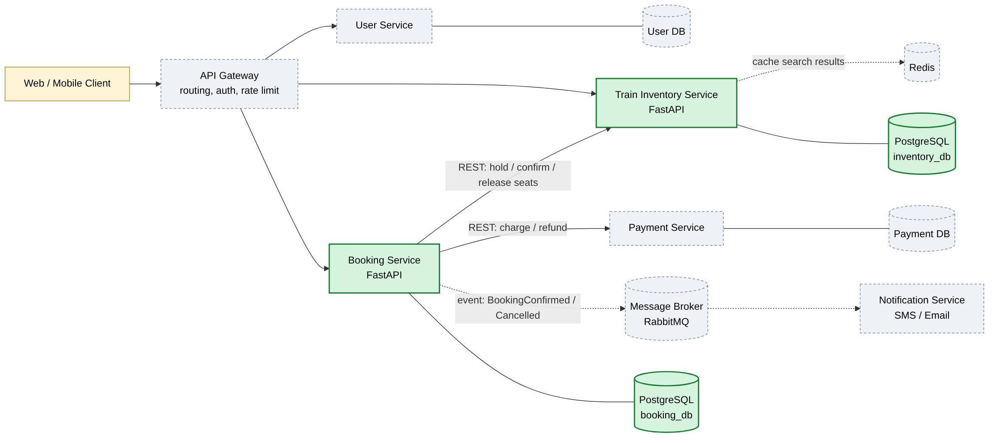
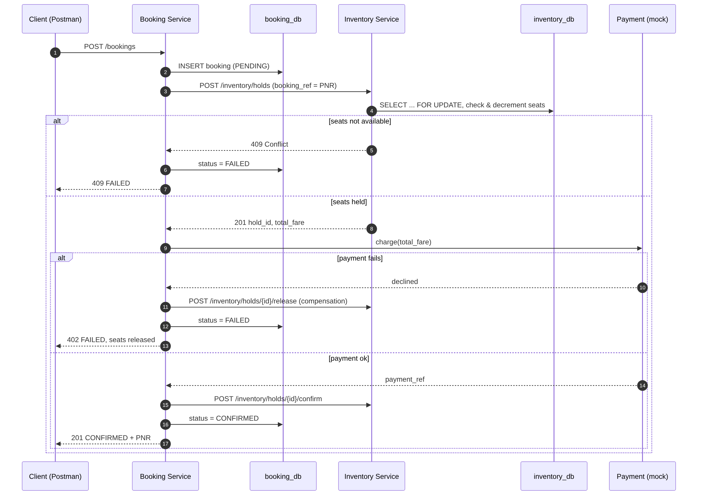
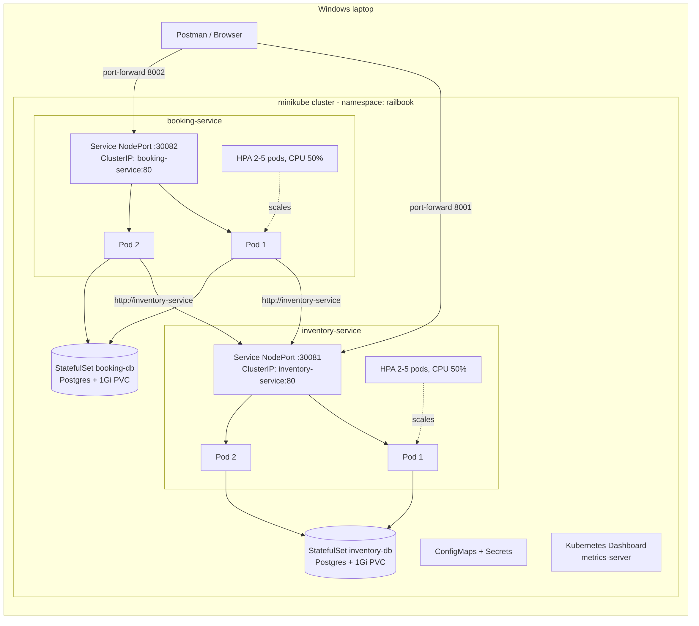

<div align="center">

# 🚆 RailBook — Deployment

**Microservices train-ticket reservation system on Kubernetes: two FastAPI services, a booking saga, StatefulSet databases and HPA autoscaling.**


</div>

| Repo | What it owns |
|---|---|
| [**inventory-service**](https://github.com/anubhav1941/inventory-service) | Trains, schedules, seat inventory, seat holds |
| [**booking-service**](https://github.com/anubhav1941/booking-service) | Bookings / PNR, booking saga orchestration |
| **railbook-deploy** (this repo) | Docker Compose, Kubernetes manifests, scripts, Postman tests, diagrams |

> Academic project: BITS WILP, SEZG583 Scalable Services (Anubhav Arora, 2025MT03101).

## ✨ Highlights
- **Database per service:** each service owns its PostgreSQL, deployed as a StatefulSet with a 1Gi PVC.
- **Booking saga:** hold seats → take payment → confirm, or compensate by releasing seats on failure.
- **No overbooking:** seat holds lock the schedule row (`SELECT ... FOR UPDATE`), so concurrent requests on any replica can't sell the same seat twice.
- **Resilient service calls:** timeouts and retries with exponential backoff, made safe by idempotency keys.
- **Production-style Kubernetes:** liveness/readiness probes, resource limits, ConfigMaps/Secrets, and an HPA that scales inventory from 2 → 5 pods under load.
- **CI/CD:** each service is tested and its image built by GitHub Actions, then pushed to Docker Hub.

## 🏗️ Architecture
Green = implemented in these repos. Dashed = in the design, not implemented.



<details>
<summary><b>Booking saga</b> and <b>Kubernetes deployment</b> diagrams</summary>





</details>

## 🚀 Getting started
Clone all three repos into the same parent folder:
```
railbook/
├── inventory-service/
├── booking-service/
└── railbook-deploy/
```

## Contents
```
railbook-deploy/
├── docker-compose.yml          # run everything with Docker only
├── k8s/
│   ├── 00-namespace.yaml
│   ├── 10-inventory-db.yaml    # Secret + headless Service + StatefulSet (Postgres, 1Gi PVC)
│   ├── 20-booking-db.yaml
│   ├── 30-inventory-service.yaml  # ConfigMap + Deployment (2 replicas, probes, limits) + NodePort Service + HPA
│   ├── 40-booking-service.yaml
│   └── 90-load-generator.yaml  # optional, for the autoscaling demo
├── scripts/
│   ├── deploy.ps1              # minikube start -> build images -> apply manifests
│   ├── port-forward.ps1        # expose services on localhost:8001 / 8002
│   ├── demo-hpa.ps1            # generate load and watch HPA scale out
│   └── cleanup.ps1
├── postman/RailBook.postman_collection.json
└── docs/diagrams/              # architecture, booking saga, k8s deployment (Mermaid + PNG)
```

## Prerequisites (Windows)
Docker Desktop (WSL2 backend), minikube, kubectl, Git, Postman.
```powershell
winget install Docker.DockerDesktop
winget install Kubernetes.minikube
winget install Kubernetes.kubectl
winget install Git.Git
winget install Postman.Postman
```

## Option A: Docker only
```powershell
cd railbook-deploy
docker compose up --build
```
- Inventory: http://localhost:8001/docs
- Booking: http://localhost:8002/docs

`docker compose down -v` to stop and wipe data.

## Option B: Kubernetes on minikube
```powershell
cd railbook-deploy
.\scripts\deploy.ps1        # ~5 min first time
.\scripts\port-forward.ps1  # opens two windows running kubectl port-forward
minikube dashboard          # opens the Kubernetes dashboard
```
If PowerShell blocks scripts: `Set-ExecutionPolicy -Scope Process Bypass`.

Manual equivalent of `deploy.ps1`:
```powershell
minikube start --driver=docker --memory=3072 --cpus=2
minikube addons enable metrics-server
minikube image build -t railbook/inventory-service:1.0 ..\inventory-service
minikube image build -t railbook/booking-service:1.0 ..\booking-service
kubectl apply -f k8s\00-namespace.yaml -f k8s\10-inventory-db.yaml -f k8s\20-booking-db.yaml
kubectl apply -f k8s\30-inventory-service.yaml -f k8s\40-booking-service.yaml
kubectl get all -n railbook
```

### Useful commands
```powershell
kubectl get pods -n railbook -o wide
kubectl logs -n railbook -l app=booking-service --tail=50   # shows which inventory pod served each call
kubectl get hpa -n railbook
kubectl describe deployment booking-service -n railbook
kubectl scale deployment inventory-service -n railbook --replicas=3
kubectl delete pod -n railbook -l app=inventory-service      # self-healing demo: pods come back
```

### Autoscaling demo
```powershell
.\scripts\demo-hpa.ps1
```
inventory-service goes from 2 to up to 5 pods within 1 to 2 minutes. Ctrl+C stops it.

## Testing with Postman
Import `postman/RailBook.postman_collection.json`, then run the collection (Runner) or request by request.
Variables `inventory_url` / `booking_url` default to `http://localhost:8001` / `http://localhost:8002`.
The flow covers: search → book (CONFIRMED) → PNR status → payment failure (seats released) →
sold out (409) → cancel (seats back) → unknown PNR (404).

## Cleanup
```powershell
.\scripts\cleanup.ps1
minikube stop
```
